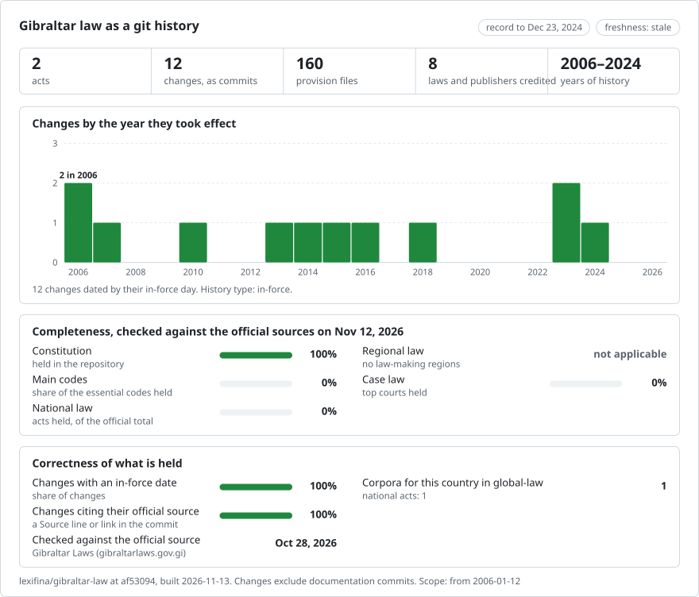

# Gibraltar: law history in git

<picture>
<source media="(prefers-color-scheme: dark)" srcset="data/effort-dark.svg">

</picture>

The law of Gibraltar as a git history: one file per section, one commit per version on the day it took effect, and the enactment that made each change as the commit's author. `git blame` names the enactment behind every line; `git log` lists every change to a section; picking a date gives the text in force that day.

Part of [lexifina/global-law](https://github.com/lexifina/global-law), one git history for every country's law: this is Gibraltar's national law, which global-law reads at `gibraltar/national/acts/`.

**What is in it now:** two texts: the Gibraltar Constitution Order 2006, with the Constitution, in the one version the official site publishes (in force from 2 January 2007); and the Stamp Duties Act 2005, in 11 versions from 12 January 2006 to 23 December 2024, made by the act and six amending enactments. [`enactments.csv`](enactments.csv) lists each enactment with the day it took effect and the provisions it affects; [`stamp-duties/README.md`](stamp-duties/README.md) and [`constitution/README.md`](constitution/README.md) list every provision and its changes.

Each act has its own folder, one file per section: `stamp-duties/s-019B.md` is section 19B of the Stamp Duties Act and `stamp-duties/sch-1.md` its Schedule 1, the duty on each kind of instrument. The Constitution is Annex 1 to the Order, in `constitution/annex1/` (`s-008.md` is section 8, protection of law); the Order's own sections are in `constitution/order/` and the transitional provisions in `constitution/annex2/`.

The text is in English, as the Government of Gibraltar's Gibraltar Laws site prints it in its PDFs.

## Questions as git commands

| Question | Command |
| --- | --- |
| Every change to Schedule 1 of the Stamp Duties Act | `git log -p --word-diff -- stamp-duties/sch-1.md` |
| Which enactment wrote each line of Schedule 1? | `git blame stamp-duties/sch-1.md` |
| Every version of Schedule 1, with the day each took effect | `git log --format="%h %(trailers:key=In-force,valueonly,separator=) %an" -- stamp-duties/sch-1.md` |
| Schedule 1 as in force on 1 January 2019 | `python tools/on_date.py 2019-01-01 stamp-duties sch-1` |

**Outside git**, we also host this record publicly, for free:

- **[Ask Claude about Gibraltar law](https://global-law.lexifina.com/v1/try_claude?country=gibraltar)**: opens Claude with a first question ready.
- **[Ask ChatGPT](https://global-law.lexifina.com/v1/try_chatgpt?country=gibraltar)**: the same question in ChatGPT.
- **[Search Gibraltar law on our site](https://lexifina.com/law?country=gibraltar&q=stamp+duty)**: a search for "stamp duty", with each provision's text and its versions, no account needed.
- **[Developer REST API](https://global-law.lexifina.com/v1/search_law?query=stamp+duty&jurisdiction=gibraltar)**: the same search as JSON, with no key. See the [documentation here](https://lexifina.com/api/global-law).

Both assistants read the record through the free Global law connector (MCP, `https://global-law.lexifina.com/mcp`); the first time, the chat gives you the link that adds it. Ask in English.

**Host it yourself easily.** All it takes is git and Python, and the tools run on your machine:

```sh
git clone --depth 1 https://github.com/lexifina/global-law && cd global-law
python3 tools/countries.py add gibraltar/national/acts
python3 tools/law.py show 2026-01-01 gibraltar/national/acts/stamp-duties/sch-1.md
```

Opened in Claude Code, Cursor, VS Code or Codex, the clone also starts a local MCP server with the same tools ([MCP.md](https://github.com/lexifina/global-law/blob/main/MCP.md)).

## Dates

Each commit is dated at noon, Europe/Gibraltar, on the day the version took effect, and carries it in its `In-force:` trailer:

- for each version, the day given in the table of amending enactments that opens its PDF, which is also the day the site gives the version;
- the first version of the Stamp Duties Act is the act as enacted, dated 12 January 2006, the day it was brought into operation (LN.2006/001); the Constitution's one version is dated 2 January 2007;
- some days are earlier than the enactment itself (Act 2024-37, assented to in December 2024, changed Schedule 1 from 11 July 2023): the commit keeps the in-force day, and its `Enacted:` trailer gives the later one.

Each change is credited to the amending enactment the table gives for its day (`Act 2019-25`); where the table does not name the provision, it is credited by date only, as its `Evidence:` trailer says (sections 24 and 25 on 1 July 2018). The Constitution is credited to `Gibraltar Constitution Order 2006`.

## How it is checked

- `tools/check_repo.py` reads every version back from git on the day it took effect and compares it, file by file, with the text parsed afresh from the PDF, and word for word with PyMuPDF's own word list: 12 versions, 718 files and 144,770 words, with no mismatch.
- `tools/test_repo.py` checks that blame names an enactment, that the text differs before and after an amendment, and that the log, the tags and every commit's trailers are in order.
- A second build from the same data gave the same hashes for all 12 law commits and 24 tags. The results and the commands are in [`REPRODUCE.md`](REPRODUCE.md).
- History is append-only: later changes are appended, never forced.

## What it does not show

- **Most Gibraltar law.** Only these two texts: no other act, no subsidiary legislation and no case law. The site publishes every act in dated versions; the Crimes Act 2011 (28 versions) was considered and passed over as larger.
- **Amendments to the Constitution.** The site lists the Gibraltar Laws (General Amendment) (No.1) Act 2007 as amending the Order but gives no later text, so none is applied.
- **The authentic text.** Only the Gazette's paper editions are authentic; this text is read from the site's PDFs, and their layout (columns, indentation) is lost.
- **Changes within a line.** Each paragraph is one line, so blame credits a whole paragraph to the enactment that changed one word of it.

## Sources

| Source | Kind | Past versions | Notes |
| --- | --- | --- | --- |
| [Gibraltar Laws](https://www.gibraltarlaws.gov.gi) (Government of Gibraltar) | Official legislation site | yes, every dated version as a PDF | Each version's text and its table of amending enactments; each amending act's page and PDF give its assent day and Gazette issue |

## Licence

See [`LICENSE`](LICENSE). The Gibraltar Laws site states no licence and no terms for reuse, so reuse terms are unclear; its PDFs carry "(c) Government of Gibraltar (www.gibraltarlaws.gov.gi)". The scripts in `tools/` are the only part of this repository that Lexifina licenses.

No AI model wrote or changed legal text; the scripts were written by an AI model (see [`REPRODUCE.md`](REPRODUCE.md)).

## More

From [lexifina/global-law](https://github.com/lexifina/global-law):

- [FEATURES.md](https://github.com/lexifina/global-law/blob/main/FEATURES.md): every feature, and what every corpus must support (`git blame`, `law.py`, the MCP tools)
- [FAQ.md](https://github.com/lexifina/global-law/blob/main/FAQ.md): questions and answers · [CONTRIBUTING.md](https://github.com/lexifina/global-law/blob/main/CONTRIBUTING.md): proposing changes · [MCP.md](https://github.com/lexifina/global-law/blob/main/MCP.md): the MCP server · [REPRODUCE.md](https://github.com/lexifina/global-law/blob/main/REPRODUCE.md): how it was built · [CHANGELOG.md](https://github.com/lexifina/global-law/blob/main/CHANGELOG.md)
- [FRESHNESS.md](https://github.com/lexifina/global-law/blob/main/FRESHNESS.md): how current each corpus is · [Monitoring](https://github.com/lexifina/global-law/tree/main/monitoring): whether updates are running · [WATCHING.md](https://github.com/lexifina/global-law/blob/main/WATCHING.md): how each official source is watched for changes
- [performance/](https://github.com/lexifina/global-law/tree/main/performance): how fast the tools are, measured
- [visualisations/](https://github.com/lexifina/global-law/tree/main/visualisations): charts and bridges across the world's law
- [Vulnerabilities](https://github.com/lexifina/global-law/tree/main/vulnerabilities): mistakes in legislation as published
